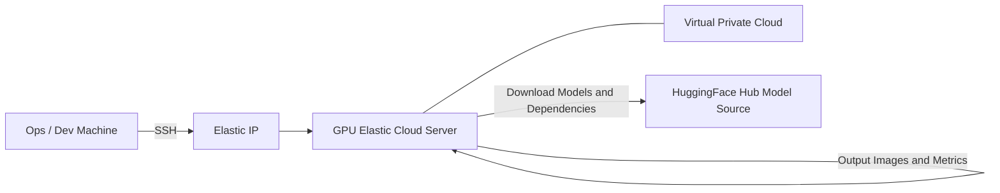

# GPU Image Editing Inference & Benchmark Tool

[](LICENSE)
[](https://support.huaweicloud.com/intl/en-us/)
[](#)

> Run an image-editing inference and benchmarking tool on a GPU-accelerated Elastic Cloud Server on Huawei Cloud.
> GPU Image Editing Inference & Benchmark Tool — run on Huawei Cloud GPU compute.

---

## 1. Overview [CRITICAL]

This reference architecture provisions a GPU-accelerated Elastic Cloud Server on Huawei Cloud and runs a Hugging Face Diffusers-based image-editing inference benchmark. It supports the Qwen Image Edit Plus and Flux Kontext pipelines (vanilla and GGUF-quantized), collects per-step timing metrics, and is suitable for model comparison and performance evaluation.

### Core Capabilities

- Supports multiple image-editing pipelines (Qwen / Flux) and quantization forms (vanilla / GGUF)
- Reproducible experiments: fixed random seed, unified preprocessing, per-step timing
- Structured output: images saved to `output_images/`, metrics saved to `output_metrics/`
- Infrastructure as code: one-click creation of compute and network resources via Terraform

---

## 2. Table of Contents [MINOR]

- [1. Overview](#1-overview-critical)
- [2. Table of Contents](#2-table-of-contents-minor)
- [3. Architecture Diagram](#3-architecture-diagram-minor)
- [4. Highlights](#4-highlights-minor)
- [5. Cloud Services](#5-cloud-services-minor)
- [6. Prerequisites](#6-prerequisites-critical)
- [7. Quick Start](#7-quick-start-critical)
- [8. Step-by-Step Deployment](#8-step-by-step-deployment-minor)
- [9. Usage / Verification](#9-usage--verification-critical)
- [10. Cleanup](#10-cleanup-minor)
- [11. Detailed Reference](#11-detailed-reference-minor)
- [12. Dependencies](#12-dependencies-minor)
- [13. FAQ / Troubleshooting](#13-faq--troubleshooting-minor)
- [14. Contributing](#14-contributing-minor)
- [15. License](#15-license-critical)
- [16. Contact](#16-contact-critical)
- [17. Creator / Maintainer](#17-creator--maintainer-critical)

---

## 3. Architecture Diagram [MINOR]

> A GPU Elastic Cloud Server created by Terraform runs the benchmark tool and pulls models and dependencies through an Elastic IP.



**Key Components**:

- Elastic Cloud Server (ECS): hosts the inference benchmark tool and runs image editing on the GPU
- Virtual Private Cloud (VPC) / Subnet: isolated compute network plane
- Elastic IP: provides public inbound/outbound capability for login and resource pulling
- Key Pair: SSH public-key login, avoids password risk

---

## 4. Highlights [MINOR]

- **GPU Acceleration**: runs large-model inference on a GPU-accelerated instance, significantly reducing per-step latency
- **Reproducible**: fixed random seed and unified preprocessing, convenient for horizontal comparison across models / quantization forms
- **Per-Step Timing**: outputs the latency of each inference step for performance profiling
- **One-Click Deployment**: Terraform uniformly manages network and compute resources, environment is rebuildable

---

## 5. Cloud Services [MINOR]

| Service | Purpose | Notes |
|---|---|---|
| Elastic Cloud Server (ECS) | Runs the benchmark tool (GPU-accelerated) | Flavor varies by region availability |
| Virtual Private Cloud (VPC) | Isolated network plane | Used together with subnet |
| Security Group | Inbound / outbound traffic control | SSH recommended to restrict to ops machine IP |
| Elastic IP | Public inbound/outbound capability | Used for login and pulling models / dependencies |
| Key Pair | SSH login credential | Based on public key |

> **Tip**: All services can be created with one click via the Terraform in this repository; for cleanup see [Section 10 "Cleanup"](#10-cleanup-minor).

> **Resource specifications and usage notes**: see [Section 11 "Detailed Reference"](#11-detailed-reference-minor).

---

## 6. Prerequisites [CRITICAL]

| Item | Requirement | Notes |
|---|---|---|
| **Account** | Huawei Cloud account with real-name authentication | Personal / enterprise accounts both OK |
| **Permissions** | Account has permission to create VPC / ECS / EIP resources | Project administrator recommended |
| **Region** | `cn-north-4` recommended | Confirm target region offers GPU-accelerated instances and images |
| **Terraform** | `>= 1.5.0` | IaC deployment tool |
| **huaweicloud Provider** | `>= 1.97.0` | Huawei Cloud Terraform Provider |
| **SSH Key Pair** | Public key generated | For logging into the Elastic Cloud Server |
| **AK/SK** | Access key created, provided via environment variables at runtime | **Do not write credentials into repository files** |

> **How credentials are provided**:
> ```bash
> export TF_VAR_access_key="<AK>"
> export TF_VAR_secret_key="<SK>"
> ```
> Any `.tf` file or document in the repository uses placeholders only; no real credentials appear.

---

## 7. Quick Start [CRITICAL]

### One-Click Deployment (Recommended)

```bash
# 1. Clone this repository
git clone <repository HTTPS URL> gpu-diffusers-bench
cd gpu-diffusers-bench

# 2. Configure access credentials (see Prerequisites)
export TF_VAR_access_key="<AK>"
export TF_VAR_secret_key="<SK>"

# 3. Prepare variables and deploy
cd infra
cp terraform.tfvars.example terraform.tfvars
#   edit terraform.tfvars, fill in ssh_public_key and image_id
terraform init
terraform apply -auto-approve
```

> **Deployment time**: about 5–10 minutes (including instance startup and runtime environment initialization).
> **Full steps and expected output per step**: see [Section 8 "Step-by-Step Deployment"](#8-step-by-step-deployment-minor).

---

## 8. Step-by-Step Deployment [MINOR]

### Step 1: Initialize

```bash
cd infra
terraform init
```

**Expected output**: `Terraform has been successfully initialized!`

### Step 2: Preview Changes

```bash
terraform plan
```

**Expected output**: `Plan: N to add, 0 to change, 0 to destroy.`

### Step 3: Apply Deployment

```bash
terraform apply -auto-approve
```

**Expected output**: `Apply complete! Resources: N added, 0 changed, 0 destroyed.`

### Step 4: Record Key Outputs

```bash
terraform output
```

**Expected output**: lists `ecs_public_ip`, `ecs_id`, etc. Save them for login and verification.

---

## 9. Usage / Verification [CRITICAL]

> **Mandatory hands-on test**: the commands in this section are the benchmark flow executed on the Elastic Cloud Server after deployment. Follow the steps to verify that the business functionality is usable before treating delivery as complete.

### Verification 1: Log in and Initialize the Runtime

```bash
ssh root@<ecs_public_ip>
scp -r ../src root@<ecs_public_ip>:/opt/diffusers-bench
ssh root@<ecs_public_ip> "bash /opt/diffusers-bench/setup.sh"
```

**Expected output**: before the script finishes it prints `cuda available: True` and the GPU device name.

### Verification 2: Run One Inference

```bash
ssh root@<ecs_public_ip>
source /opt/diffusers-bench/venv/bin/activate
cd /opt/diffusers-bench
python main.py --pipeline_vendor QwenImageEditPlusPipeline --model_type vanilla --steps 10 --cfg 4
```

**Expected output**:

```
Image saved to: output_images/<run_id>.png
Metrics saved to: output_metrics/<run_id>.csv
```

### Verification 3: Check Artifacts

```bash
ssh root@<ecs_public_ip> "ls -lh /opt/diffusers-bench/output_images /opt/diffusers-bench/output_metrics"
```

**Expected result**: a PNG image exists under `output_images/`, and a CSV metrics file exists under `output_metrics/` (with header `run_id, model_type, model_path, step, timestamp, time_sec`).

### Verification 4: GGUF Quantized Model (Optional)

```bash
ssh root@<ecs_public_ip> "cd /opt/diffusers-bench && make flux_gguf_q8"
```

**Expected result**: the Flux Kontext GGUF model completes inference and writes images and metrics.

---

## 10. Cleanup [MINOR]

```bash
# Enter the deployment directory
cd infra

# Release all resources with one click
terraform destroy -auto-approve
```

**Expected output**: `Destroy complete! Resources: N destroyed.`

> **Avoid resource residue**: `terraform destroy` only releases resources tracked in the Terraform state; after release, confirm on the console that network and compute instances leave no residue.

---

## 11. Detailed Reference [MINOR]

### Workflow

1. Locally run `terraform apply` to create the network and GPU compute instance.
2. After the instance starts, cloud-init installs the Python runtime and virtual environment.
3. Log in, upload `src/`, and run `setup.sh` to install dependencies.
4. Run `main.py` (or the `make` preset cases) to pull the model and perform inference.
5. Images are written to `output_images/`, per-step timing is written to `output_metrics/`.

### Configuration Items (Terraform Variables)

| Variable | Default | Notes |
|---|---|---|
| `region` | `cn-north-4` | Region |
| `project_name` | `gpu-diffusers-bench` | Resource naming prefix |
| `availability_zone` | `cn-north-4a` | Availability zone |
| `ecs_flavor_id` | `p2s.2xlarge.8` | GPU instance flavor (confirm per region) |
| `image_id` | Required | GPU-accelerated public image ID |
| `system_disk_size` | `200` | System disk capacity (GiB) |
| `ssh_source_cidr` | `0.0.0.0/0` | SSH inbound source CIDR (recommended to restrict) |
| `app_code_url` | `""` | Optional code package URL |

### Interface / Usage

`main.py` is driven by command-line arguments; key arguments:

| Argument | Notes |
|---|---|
| `--pipeline_vendor` | `QwenImageEditPlusPipeline` or `FluxKontextPipeline` |
| `--model_type` | `vanilla` or `GGUF` |
| `--steps` | Number of inference steps |
| `--cfg` | Classifier-free guidance scale |
| `--device` | `cuda` (default) or `cpu` |
| `--image_input` | Input image path or URL |
| `--prompt_positive` | Editing prompt |

---

## 12. Dependencies [MINOR]

### Main Dependencies

| Name | Version | Purpose |
|---|---|---|
| Terraform | `>= 1.5.0` | IaC orchestration |
| huaweicloud Provider | `>= 1.97.0` | Huawei Cloud resources |
| Python | `>= 3.10` | Runtime |
| PyTorch | `2.8.0` | Inference framework (CUDA 12.8) |
| Diffusers | Built from source (pinned commit) | Image-editing pipeline |
| Hugging Face Hub | `0.35.3` | Model weight pulling |

---

## 13. FAQ / Troubleshooting [MINOR]

### Q1: Insufficient permissions during deployment?

**A**: Confirm the account has permission to create VPC / ECS / EIP resources, or at least includes administrative permission for the corresponding services.

### Q2: GPU not recognized after instance startup?

**A**: Confirm the selected public image has NVIDIA driver / CUDA preinstalled; if using an ordinary image, install the driver yourself and retry.

### Q3: Dependency installation takes too long or is interrupted?

**A**: PyTorch and Diffusers are large; ensure sufficient Elastic IP bandwidth; you may use a nearby PyPI mirror to speed up.

### Troubleshooting Checklist

| Symptom | Possible Cause | Troubleshooting |
|---|---|---|
| SSH connection timeout | Security group does not allow port 22 | Check security group inbound rules and `ssh_source_cidr` |
| `cuda available: False` | Image lacks driver / non-GPU flavor | Switch to a GPU-accelerated image and flavor |
| Model download fails | No public outbound | Check Elastic IP and outbound security group rules |

---

## 14. Contributing [MINOR]

Issues and PRs are welcome. Please follow this flow:

1. **Issue**: describe the problem / suggestion (including reproduction commands, expected / actual output).
2. **PR**: create a branch from `main`; run `terraform validate` before submitting.
3. **Code Review**: merged after review by a maintainer.

---

## 15. License [CRITICAL]

This practice is published under the **MIT No Attribution** license. See the [`LICENSE`](LICENSE) file in the repository root.

```
MIT No Attribution

Copyright (c) Huawei Cloud

Permission is hereby granted, free of charge, to any person obtaining a copy
of this software... (no attribution required)
```

> License provenance and related statements are provided with the repository.

---

## 16. Contact [CRITICAL]

| Item | Content |
|---|---|
| **Feedback Channel** | Submit an Issue / PR |

---

## 17. Creator / Maintainer [CRITICAL]

| Item | Content |
|---|---|
| **Creator** | zhangcheng123321 |
| **Maintainer** | zhangcheng123321 |
