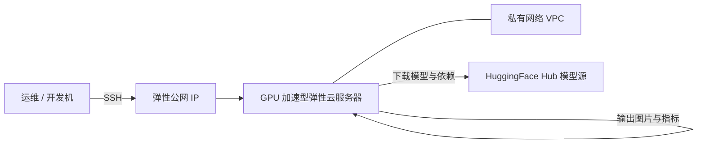

# GPU Image Editing Inference & Benchmark Tool

[](LICENSE)
[](https://support.huaweicloud.com/intl/en-us/)
[](#)

> 在华为云 GPU 加速型弹性云服务器上运行基于 Hugging Face Diffusers 的图像编辑推理与基准测试工具。
> GPU Image Editing Inference & Benchmark Tool — run on Huawei Cloud GPU compute.

---

## 1. 简介 / Overview [CRITICAL]

**中文**：本实践提供一套在华为云上一键创建 GPU 加速型弹性云服务器并运行图像编辑推理基准测试的方案。工具支持 Qwen Image Edit Plus 与 Flux Kontext 两类管线，包含 vanilla 与 GGUF 量化模型，可采集逐步骤耗时指标，便于模型对比与性能评估。

**English**: This reference architecture provisions a GPU-accelerated Elastic Cloud Server on Huawei Cloud and runs a Hugging Face Diffusers-based image-editing inference benchmark. It supports the Qwen Image Edit Plus and Flux Kontext pipelines (vanilla and GGUF-quantized), collects per-step timing metrics, and is suitable for model comparison and performance evaluation.

### 核心能力

- 支持多种图像编辑管线（Qwen / Flux）与量化形态（vanilla / GGUF）
- 可复现的实验：固定随机种子、统一预处理、逐步骤计时
- 结构化输出：图片保存至 `output_images/`，指标保存至 `output_metrics/`
- 基础设施即代码：通过 Terraform 一键创建计算与网络资源

---

## 2. 目录 [MINOR]

- [1. 简介](#1-简介--overview-critical)
- [2. 目录](#2-目录-minor)
- [3. 架构图](#3-架构图-minor)
- [4. 方案亮点](#4-方案亮点-minor)
- [5. 涉及云服务](#5-涉及云服务-minor)
- [6. 前置条件](#6-前置条件-critical)
- [7. 快速开始](#7-快速开始-critical)
- [8. 分步部署](#8-分步部署-minor)
- [9. 使用方法 / 验证](#9-使用方法--验证-critical)
- [10. 清理资源](#10-清理资源-minor)
- [11. 详细说明](#11-详细说明-minor)
- [12. 依赖](#12-依赖-minor)
- [13. FAQ / 故障排除](#13-faq--故障排除-minor)
- [14. 贡献指南](#14-贡献指南-minor)
- [15. 许可证](#15-许可证-critical)
- [16. 联系方式](#16-联系方式-critical)
- [17. 创建者 / 维护者](#17-创建者--维护者-critical)

---

## 3. 架构图 [MINOR]

> 由 Terraform 创建的 GPU 弹性云服务器运行基准测试工具，经弹性公网 IP 拉取模型与依赖。



**关键组件说明**：
- 弹性云服务器（ECS）：承载推理基准测试工具，利用 GPU 完成图像编辑
- 私有网络 VPC / 子网：隔离的计算网络平面
- 弹性公网 IP：提供公网出入能力，用于登录与拉取资源
- 密钥对：基于 SSH 公钥登录，避免口令风险

---

## 4. 方案亮点 [MINOR]

- **GPU 加速**：在 GPU 加速型实例上运行大模型推理，显著缩短单步耗时
- **可复现**：固定随机种子与统一预处理，便于横向对比不同模型 / 量化形态
- **逐步骤计时**：输出每个推理步骤的耗时，便于性能剖析
- **一键部署**：Terraform 统一管理网络与计算资源，环境可重建

---

## 5. 涉及云服务 [MINOR]

| 服务 | 用途 | 备注 |
|---|---|---|
| 弹性云服务器（ECS） | 运行基准测试工具（GPU 加速型） | 规格随区域可选列表变化 |
| 虚拟私有云（VPC） | 隔离的网络平面 | 与子网配套 |
| 安全组 | 入站 / 出站流量控制 | SSH 建议收敛到运维机 IP |
| 弹性公网 IP | 公网出入能力 | 用于登录与拉取模型 / 依赖 |
| 密钥对 | SSH 登录凭据 | 基于公钥 |

> **提示**：所有服务均可通过本仓库的 Terraform 一键创建；如需清理，请参见 [第 10 节「清理资源」](#10-清理资源-minor)。

> **资源规格与用量说明**：各服务的规格与部署用量说明见第 11 节「详细说明」。

---

## 6. 前置条件 [CRITICAL]

| 项 | 要求 | 说明 |
|---|---|---|
| **账号** | 已开通华为云账号并完成实名认证 | 个人 / 企业账号均可 |
| **权限** | 账号具备创建 VPC / ECS / EIP 等资源权限 | 推荐项目管理员权限 |
| **Region** | 推荐 `cn-north-4` | 需确认目标区域提供 GPU 加速型实例与镜像 |
| **Terraform** | `>= 1.5.0` | IaC 部署工具 |
| **huaweicloud Provider** | `>= 1.97.0` | 华为云 Terraform Provider |
| **SSH 密钥对** | 已生成公钥 | 用于登录弹性云服务器 |
| **AK/SK** | 已创建访问密钥，运行时经环境变量提供 | **请勿写入仓库文件** |

> **凭据提供方式**：
> ```bash
> export TF_VAR_access_key="<AK>"
> export TF_VAR_secret_key="<SK>"
> ```
> 仓库内任何 `.tf` / 文档均使用占位符，不出现真实凭据。

---

## 7. 快速开始 [CRITICAL]

### 一键部署（推荐）

```bash
# 1. 克隆本仓库
git clone <本仓库 HTTPS URL> gpu-diffusers-bench
cd gpu-diffusers-bench

# 2. 配置访问凭据（见前置条件）
export TF_VAR_access_key="<AK>"
export TF_VAR_secret_key="<SK>"

# 3. 准备变量并部署
cd infra
cp terraform.tfvars.example terraform.tfvars
#   编辑 terraform.tfvars，填入 ssh_public_key 与 image_id
terraform init
terraform apply -auto-approve
```

> **部署耗时**：约 5–10 分钟（含实例启动与运行环境初始化）。
> **完整步骤与每步预期输出**：参见 [第 8 节「分步部署」](#8-分步部署-minor)。

---

## 8. 分步部署 [MINOR]

### 步骤 1：初始化

```bash
cd infra
terraform init
```

**预期输出**：`Terraform has been successfully initialized!`

### 步骤 2：预演变更

```bash
terraform plan
```

**预期输出**：`Plan: N to add, 0 to change, 0 to destroy.`

### 步骤 3：执行部署

```bash
terraform apply -auto-approve
```

**预期输出**：`Apply complete! Resources: N added, 0 changed, 0 destroyed.`

### 步骤 4：记录关键输出

```bash
terraform output
```

**预期输出**：列出 `ecs_public_ip`、`ecs_id` 等字段，请妥善保存用于登录与验证。

---

## 9. 使用方法 / 验证 [CRITICAL]

> **强制实测**：本节所列命令为部署后在弹性云服务器上执行的基准测试流程。请按本节步骤自行验证，确认业务功能可用后方可视为交付完成。

### 验证 1：登录实例并初始化运行环境

```bash
ssh root@<ecs_public_ip>
scp -r ../src root@<ecs_public_ip>:/opt/diffusers-bench
ssh root@<ecs_public_ip> "bash /opt/diffusers-bench/setup.sh"
```

**预期输出**：脚本结束前打印 `cuda available: True` 与 GPU 设备名称。

### 验证 2：运行一次推理

```bash
ssh root@<ecs_public_ip>
source /opt/diffusers-bench/venv/bin/activate
cd /opt/diffusers-bench
python main.py --pipeline_vendor QwenImageEditPlusPipeline --model_type vanilla --steps 10 --cfg 4
```

**预期输出**：
```
Image saved to: output_images/<run_id>.png
Metrics saved to: output_metrics/<run_id>.csv
```

### 验证 3：检查产物

```bash
ssh root@<ecs_public_ip> "ls -lh /opt/diffusers-bench/output_images /opt/diffusers-bench/output_metrics"
```

**预期结果**：`output_images/` 下存在 PNG 图片，`output_metrics/` 下存在 CSV 指标文件（含 `run_id, model_type, model_path, step, timestamp, time_sec` 表头）。

### 验证 4：GGUF 量化模型（可选）

```bash
ssh root@<ecs_public_ip> "cd /opt/diffusers-bench && make flux_gguf_q8"
```

**预期结果**：Flux Kontext GGUF 模型完成推理并写出图片与指标。

---

## 10. 清理资源 [MINOR]

```bash
# 进入部署目录
cd infra

# 一键释放所有资源
terraform destroy -auto-approve
```

**预期输出**：`Destroy complete! Resources: N destroyed.`

> **避免资源残留**：`terraform destroy` 仅释放 Terraform state 中追踪的资源；释放后请到控制台确认网络与计算实例已无遗留。

---

## 11. 详细说明 [MINOR]

### 工作流程

1. 本地执行 `terraform apply` 创建网络与 GPU 计算实例。
2. 实例启动后，cloud-init 安装 Python 运行环境与虚拟环境。
3. 登录实例，上传 `src/` 并运行 `setup.sh` 安装依赖。
4. 运行 `main.py`（`make` 预置用例亦可）拉取模型并执行推理。
5. 图片写入 `output_images/`，逐步骤耗时写入 `output_metrics/`。

### 配置项（Terraform 变量）

| 变量 | 默认值 | 说明 |
|---|---|---|
| `region` | `cn-north-4` | 区域 |
| `project_name` | `gpu-diffusers-bench` | 资源命名前缀 |
| `availability_zone` | `cn-north-4a` | 可用区 |
| `ecs_flavor_id` | `p2s.2xlarge.8` | GPU 实例规格（按区域确认） |
| `image_id` | 必填 | GPU 加速型公共镜像 ID |
| `system_disk_size` | `200` | 系统盘容量（GiB） |
| `ssh_source_cidr` | `0.0.0.0/0` | SSH 入站源 CIDR（建议收敛） |
| `app_code_url` | `""` | 可选代码包 URL |

### 接口 / 用法

`main.py` 通过命令行参数驱动，关键参数：

| 参数 | 说明 |
|---|---|
| `--pipeline_vendor` | `QwenImageEditPlusPipeline` 或 `FluxKontextPipeline` |
| `--model_type` | `vanilla` 或 `GGUF` |
| `--steps` | 推理步数 |
| `--cfg` | Classifier-free guidance 系数 |
| `--device` | `cuda`（默认）或 `cpu` |
| `--image_input` | 输入图片路径或 URL |
| `--prompt_positive` | 编辑提示词 |

---

## 12. 依赖 [MINOR]

### 主要依赖

| 名称 | 版本 | 用途 |
|---|---|---|
| Terraform | `>= 1.5.0` | IaC 编排 |
| huaweicloud Provider | `>= 1.97.0` | 华为云资源 |
| Python | `>= 3.10` | 运行环境 |
| PyTorch | `2.8.0` | 推理框架（CUDA 12.8） |
| Diffusers | 源码构建（指定 commit） | 图像编辑管线 |
| Hugging Face Hub | `0.35.3` | 模型权重拉取 |

---

## 13. FAQ / 故障排除 [MINOR]

### Q1：部署时提示权限不足怎么办？

**A**：确认账号具备创建 VPC / ECS / EIP 等资源的权限，或至少包含对应服务的管理权限。

### Q2：实例启动后无法识别 GPU 怎么办？

**A**：确认所选公共镜像已预装 NVIDIA 驱动 / CUDA；若使用普通镜像，需自行安装驱动后重试。

### Q3：依赖安装耗时过长或中断？

**A**：PyTorch 与 Diffusers 体积较大，请确保弹性公网 IP 带宽充足；可改用就近的 PyPI 镜像源加速。

### 故障排查清单

| 现象 | 可能原因 | 排查方法 |
|---|---|---|
| SSH 连接超时 | 安全组未放行 22 端口 | 检查安全组入站规则与 `ssh_source_cidr` |
| `cuda available: False` | 镜像缺驱动 / 非 GPU 规格 | 更换 GPU 加速型镜像与规格 |
| 模型下载失败 | 无公网出口 | 检查弹性公网 IP 与出站安全组规则 |

---

## 14. 贡献指南 [MINOR]

欢迎提交 Issue 与 PR。请遵循以下流程：

1. **Issue**：描述问题 / 建议（含复现命令、预期 / 实际输出）。
2. **PR**：基于 `main` 分支新建分支；提交前运行 `terraform validate`。
3. **Code Review**：由 zhangcheng123321 审核通过后合并。

---

## 15. 许可证 [CRITICAL]

本实践采用 **MIT No Attribution** 许可证发布。详见仓库根目录 [`LICENSE`](LICENSE) 文件。

```
MIT No Attribution

Copyright (c) Huawei Cloud

Permission is hereby granted, free of charge, to any person obtaining a copy
of this software... (no attribution required)
```

> 许可证溯源与相关声明随仓库提供。

---

## 16. 联系方式 [CRITICAL]

| 项 | 内容 |
|---|---|
| **反馈渠道** | 提交 Issue / PR |

---

## 17. 创建者 / 维护者 [CRITICAL]

| 项 | 内容 |
|---|---|
| **创建者** | zhangcheng123321 |
| **维护者** | zhangcheng123321 |
