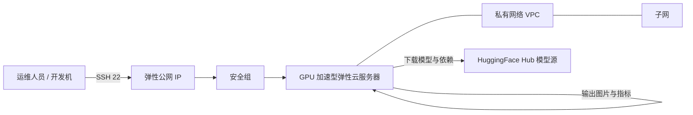

# 架构说明

> 本实践提供一套在华为云上运行 **diffusers 图像编辑推理与基准测试** 的方案：通过 Terraform 一键创建 GPU 加速型弹性云服务器（ECS）及其网络环境，在实例上运行基于 Hugging Face Diffusers 的 Python 基准测试工具，完成图像编辑模型（Qwen Image Edit Plus、Flux Kontext）的推理与逐步骤耗时采集。

## 整体架构

## 关键组件

| 组件 | 作用 |
|---|---|
| 私有网络 VPC + 子网 | 为计算实例提供隔离的网络平面 |
| 安全组 | 入站放行 SSH（可收敛到运维机 IP），出站放通全部流量 |
| 弹性公网 IP | 为实例提供公网出入能力，用于登录与拉取模型 / 软件包 |
| GPU 加速型弹性云服务器（ECS） | 承载基准测试工具，利用 GPU 完成图像编辑推理 |
| 密钥对 | 基于 SSH 公钥登录实例，避免口令泄露风险 |

## 工作流程

1. 开发者在本地执行 `terraform apply`，创建上述网络与计算资源。
2. 实例启动后，cloud-init 自动安装 Python 运行环境与虚拟环境。
3. 开发者通过 SSH 登录实例，上传 `src/` 目录并执行 `setup.sh` 安装依赖。
4. 运行 `main.py`（或 `make` 预置用例）拉取模型权重并执行推理。
5. 推理产物（图片）写入 `output_images/`，逐步骤耗时指标写入 `output_metrics/`（`run_id, model_type, model_path, step, timestamp, time_sec`）。

## 设计要点

- **计算选型**：图像编辑模型体量较大，需 GPU 加速型规格（如 p2s / g5 / pi2 系列）。具体规格随区域可选列表变化，部署前需在控制台确认可售规格。
- **镜像选型**：实例需使用已预装 NVIDIA 驱动 / CUDA 的公共镜像（或深度学习镜像），否则需自行安装驱动。
- **磁盘容量**：模型权重与 Python 依赖占用空间较大，系统盘建议 ≥ 200 GiB。
- **公网能力**：实例经弹性公网 IP 出公网拉取 HuggingFace 模型与 PyPI 依赖；若仅在内网环境中使用，可移除弹性公网 IP 并改用私网镜像源 / 模型仓库。
- **安全收敛**：生产环境建议将安全组 SSH 入站收敛到运维机 IP 段，避免 0.0.0.0/0 长期暴露。
